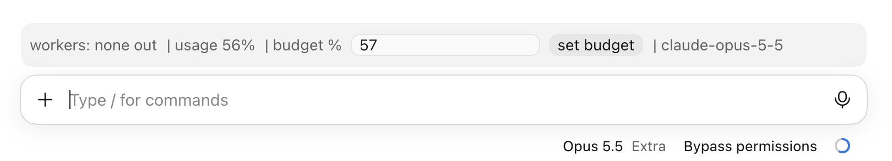
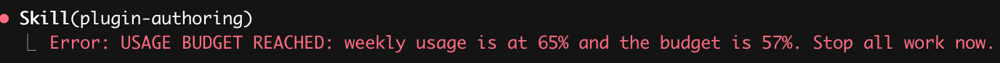
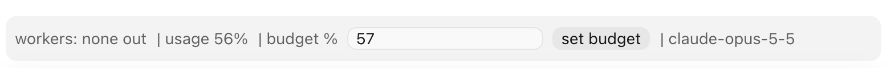

# ops-band

A parking brake for Claude Code. You choose a percent of your weekly usage allowance, and when your usage reaches it, Claude Code stops working until you say otherwise.

```
/cap 55
```

That line is the whole setup. From then on the mod checks your usage before every tool call. At 55% it refuses the call and every call after it: shell commands, file reads and edits, web requests, MCP tools, and anything a subagent tries. Claude is told why, says where it stopped, and ends its turn. No tool runs again until you raise the number or turn it off.

It is for the run you start and walk away from. A long job, or a loop that has gone wrong, can spend the rest of your week's allowance before you look at the screen again. With a budget set, the most it can spend is the amount you chose.

The mod also adds a row above your prompt, in the terminal, the desktop app and the mobile apps, so you can see where usage stands against the budget:

```
workers: 2 out, longest 6m (Build the parser, Review the parser) | usage 41% | budget % [ 55 ] | Fable 5.2
```

In the desktop app the row sits on top of the prompt box:



## Install

At the prompt of a Claude Code terminal session:

```
/plugin install ops-band --marketplace In2Deep/ops-band
```

Answer `y` to add the marketplace, then pick a scope (user scope is first; press Enter).

From a shell:

```
claude plugin install ops-band --marketplace In2Deep/ops-band
```

In the desktop app, where `/plugin` does not run: click + next to the prompt box, then Plugins, Add marketplace with `In2Deep/ops-band`, then Add plugin.

There is nothing else to set up. The mod needs no settings change and no script of its own.

## Set a budget

```
/cap 55
```

The number is a whole percent of your weekly allowance, from 1 to 100. You can also type it into the `budget %` box in the row and press Enter.

- `/cap` on its own shows the budget and your current usage.
- `/cap off` removes the budget.

In the desktop and mobile apps the box is the surest way to set it. If `/cap 55` there answers that only the person at the keyboard sets the budget, type the number into the box.

The budget is kept in a file under `~/.claude`, so it outlasts the session. Every session signed in to the same account is held to the same number, in whichever app it runs.

## One budget per account

A budget belongs to the account that set it. If you use two accounts on one machine, say a personal login in the terminal and a work login in the desktop app, each has its own number and is measured against its own usage. Setting `/cap 57` in one does not move the other.

Each account's budget is a file in `~/.claude/usage_cap.d/`, named by the account's id. The mod takes the id from the environment where the app hands the session its login, as the desktop app does, and otherwise from the login in Claude Code's own config file, `~/.claude.json`. A session whose account it cannot find uses the machine-wide file `~/.claude/usage_cap`.

An account that has not set a budget of its own is also held to `~/.claude/usage_cap` when that file exists. Versions before 0.3 kept the one budget there, so a budget you set earlier still applies after you update. `/cap` on its own tells you when that is the number in force.

## What happens when the budget is reached

1. Every tool call is refused before it runs, in the main session and in its subagents.
2. Each refusal carries this message to Claude:

   ```
   USAGE BUDGET REACHED: weekly usage is at 55% and the budget is 55%. Stop all
   work now. Do not retry this or any other tool: every tool call is refused
   until the person raises the budget. In your reply, say where you stopped and
   what is left to do, then end your turn. Only the person can lift the budget,
   by typing /cap.
   ```

   In the terminal it shows as the tool's error:

   

3. The row changes to `usage 55% BUDGET REACHED, tools refused`.
4. The session stays stopped until you type `/cap` with a higher number, or `/cap off`. If you set a budget that usage has already passed, the mod tells you and stays stopped.

When you come back, read Claude's last message, raise the budget, and tell it to carry on.

## Try it

You can watch the stop happen without waiting for a long run. Look at the usage figure in the row and set the budget to that same percent. If the row says `usage 41%`:

```
/cap 41
```

Then ask Claude to do anything that needs a tool. Usage is already at the budget, so the next tool call comes back refused and Claude stops.

To watch it trip on its own, set the budget one point above your usage instead (`/cap 42` here) and keep working. The stop comes when your usage climbs that one point, which can take a while.

Afterwards put your real budget back with `/cap 55`, or remove it with `/cap off`. Other sessions signed in to the same account are stopped too while the low budget is set, so pick a moment when nothing else is running on it.

## How the stop is enforced

The check is a `tool.call` hook, which Claude Code runs at the point where a tool is about to execute. A refused call never executes, and the model receives the refusal as an error. The model has no say in this, and with every tool refused, a text reply is all it can still produce.

The hook reads the budget file and the usage figure again on every call, so a change you make with `/cap` applies to the very next tool call.

The usage figure is the fullest usage window Claude Code reports for your account, leaving out the five-hour window, which resets on its own within the day. In practice that is the weekly window.

## Who can change the budget

Only you. `/cap` works when it is typed at your own prompt or sent from your phone through Remote Control. A `/cap` that arrives any other way is refused.

Claude cannot raise its own budget through its tools either. A file edit aimed at a budget file is refused at any usage level, and so is a shell command that names `.claude/usage_cap` or the folder beside it. That closes the direct routes. A shell command written to avoid naming the files could still reach them, so treat this as a guard rail and check `/cap` when you get back.

## Limits you should know before you rely on it

- It stops tool calls. It cannot cut off a reply that is already being written, or a tool call that was already running when usage crossed the line, so a run ends a little above the budget. Leave yourself a few points of margin.
- It needs a usage reading. Claude Code reports usage windows on a subscription. On an account that reports none, the row shows `usage ?` and nothing is refused.
- A session gets its own first reading only after its first response, and the tool calls in that response have run by then. To cover that, the mod keeps each account's last reading between sessions and holds a new session to it until the session has its own. An account's first session on a machine, and its first after the weekly reset, have no earlier reading to go by, so the tool calls of their first response run unchecked.
- The five-hour window is not budgeted.
- Sessions without the mod are not stopped. Their usage still counts toward the same weekly figure, so a session that does have the mod stops when the total gets there.
- If the check itself fails with an error, the tool call is let through, and a budget file the mod cannot read counts as no budget of that account's own. A broken check should not freeze an unattended run.

## The row



- `workers` shows how many subagents are out right now, how long the longest has been out, and what the first two are doing.
- `usage` is the weekly usage of the account the session is signed in to, as a percent.
- `budget %` is the box that holds that account's budget.
- The last segment is the model the session is running.

The row is drawn in the terminal, the desktop app and the mobile apps. It refreshes every 5 seconds. The budget check does not wait for the refresh.

## Optional: show a running job in the row

Any script of yours can add one more segment to the row while it runs. Write one line to `~/.claude/ops-band/job.status`:

```
<name> <stage> <epoch seconds when it started>
```

For example, in a shell script:

```
mkdir -p ~/.claude/ops-band
echo "deploy tests $(date +%s)" > ~/.claude/ops-band/job.status
# ... the work ...
rm -f ~/.claude/ops-band/job.status
```

The row then shows `| deploy: tests, 3m`. The name and the stage are one word each (no spaces). Remove the file when the job ends. A line older than 45 minutes is ignored.

## Updating

```
claude plugin update ops-band
```

Restart Claude Code afterwards.

From 0.2, nothing else is needed. Version 0.3 made the budget per account, and the budget you already set keeps applying as described under "One budget per account".

Version 0.1 only recorded the budget. To make it stop anything, you had to set up a separate hook script and a status line script from a prompt in the old README. From 0.2 the stop is built into the mod and reads usage from Claude Code directly, so the old hook and status line script are no longer needed. Remove them if you use more than one account on the machine: the old hook knows only the machine-wide budget, and it measures every session against whichever account's usage the status line saved last.

## Files

- `hooks/register.tsx`: the mod.
- `types/index.d.ts`: the shapes of what the mod keeps.
- `tests/cap.test.ts`: the tests. Run them with `claude plugin test .` from the repository folder.
- `docs/`: the screenshots on this page.

The mod reads the budget files (`~/.claude/usage_cap` and `~/.claude/usage_cap.d/`), `~/.claude/ops-band/job.status`, and the account id in `~/.claude.json`. It writes only the budget files, and keeps each account's last usage reading in its own plugin store. Nothing is sent anywhere.

## License

MIT No Attribution (MIT-0), by Brandon Hatch. Do anything you like with it: use it, change it, sell it. You don't have to credit me. If you build something with it, a mention is appreciated, and no hard feelings if not.
